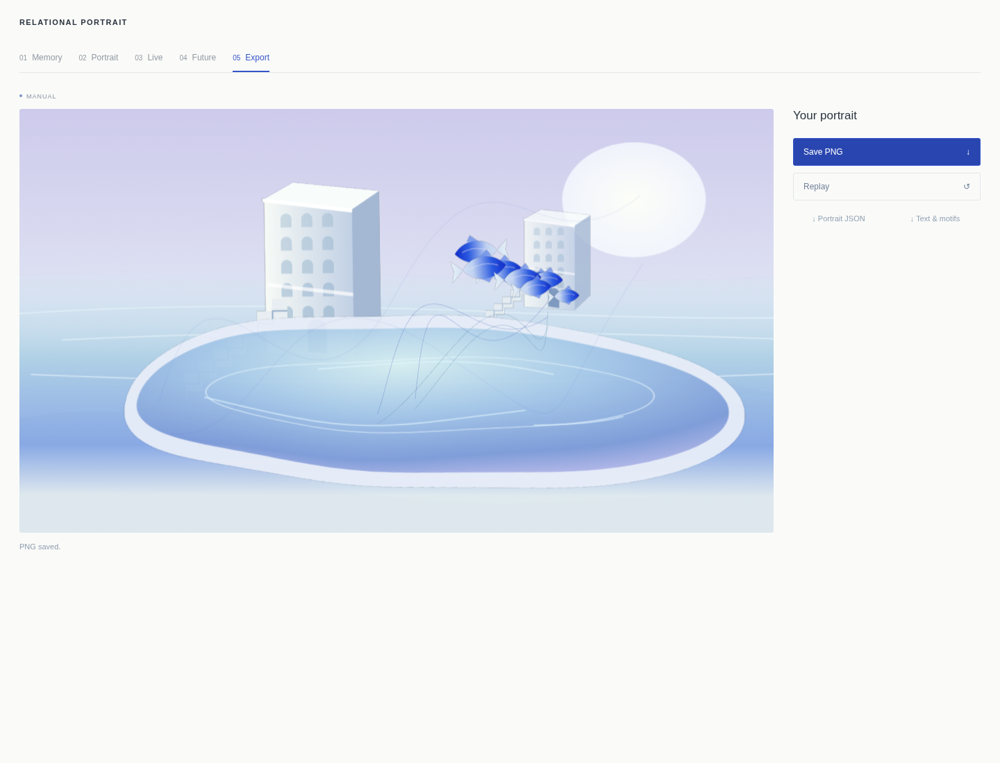

# RELATIONAL PORTRAIT — Interactive Prototype

记忆 → 空间关系 → 未来想象。一个实际运行的 Three.js 2.5D 互动艺术实验，界面使用英文。页面只保留作品、紧凑步骤栏与当前操作；标签和 PNG 上传默认折叠。独立放在 `relational-portrait/`，旧版《未名生物收容所》及其素材、下载包和入口均保留。



## 运行

开发环境：Node.js **22.12+**（本环境验证版本 24.19）与 npm。

```bash
cd relational-portrait
npm ci
npm run dev
```

在运行服务的电脑上打开终端显示的地址，默认 `http://localhost:5174/`。开发服务监听 `0.0.0.0`；摄像头只在本机 localhost/127.0.0.1 或 HTTPS 下可用。远程访问需通过支持 HTTPS 的预览或部署，普通局域网 HTTP 不具备摄像头权限。

```bash
npm run build       # TypeScript 检查 + Vite 生产构建
npm run preview     # 预览 dist，默认 4174
npm test            # 逻辑测试
npm run test:browser # Chromium / Playwright 功能测试
```

浏览器测试默认用 `/usr/bin/chromium`。其他系统先 `npx playwright install chromium`，或通过 `CHROMIUM_PATH` 指定浏览器，然后运行测试。应用本身不需要 Playwright。

### Windows 10 / 11 直接运行包

仓库 `downloads/relational-portrait-windows-v1.zip`：全部解压后双击 `start-windows.bat`。保持启动窗口打开，页面在自己的电脑上运行，不上传记忆或摄像头画面。不需要安装 Node.js、Python、npm；Three.js、WASM、模型和占位素材都已包含。不要直接双击 `app/index.html`，JavaScript 模块与模型需要 HTTP 服务。

修改源码请进入包内 `source/`，执行 `npm ci` 和 `npm run dev`。

启动器复用了旧项目的 PowerShell TCP 本机静态服务器，只监听 127.0.0.1，并自动选择空闲端口。此版本在 Linux/Chromium 中验证网页及静态构建；未在 Windows 实机上运行启动器。

## 体验流程

1. **Memory input**：默认两位参与者与题目示例。输入文字后点 **Find motifs**；展开 **Motifs** 可编辑标签、用 × 删除或自行添加。界面本轮使用两位参与者，底层使用可扩展的参与者数组。
2. **Generate portrait**：建立独立透明素材与不同深度的 2.5D 场景。初次打开的动态画面标为 **Studio preview**，不冒充已生成的个人作品。生成后才启用后续步骤。
3. **Portrait**：可直接点 **Continue** 进入互动。需要自定义素材时，展开 **PNG assets**，选择图层并上传透明 PNG。仅替换该层素材，原有空间与互动逻辑保留；PNG 限 4 MB、4096 × 4096。轻微视差自动运行，不需要鼠标控制。
4. **Live interaction**：默认 **Manual**。Distance 越小，鱼群和轨迹越聚合；越大，空间分离。Expression 在 Manual 下通过滑块模拟；在 Camera 下由 Face Landmarker 自动读取，滑块仅显示实时数值。
5. **Use camera**：允许摄像头，让两人的上半身与手腕完整进入镜头。双肩中心控制对应鱼群与轨迹的位置，双人距离控制聚合和分离，同向运动控制同步节奏，手腕高于肩控制鱼群高度。一个人左右或上下移动时，对应鱼群和轨迹也会跟随；双人靠近/远离仍需要同时识别两人。坐姿时双肩清晰可见即可，不要求腰部入镜。微笑、张嘴、抬眉或眨眼会改变鱼群高度/大小、水体宽高与轨迹波动。脸部要清晰入镜；状态显示身体数、人脸数与推理帧率；**Manual / Stop camera** 释放摄像头。摄像头画面仅用于推理，不在网页或作品中显示。
6. **Future input**：输入未来、提取并编辑标签，点 **Grow this world**。约 12 个场景秒中，池塘扩展、新海洋与建筑片段渐入，鱼与轨迹向新空间移动；初始校园与水体不会被替换。第一版每个肖像支持一个未来章节，生成新的初始肖像可开始另一轮实验。
7. **Final portrait**：导出 **1600 × 900 PNG**、**Portrait JSON**、**Text & motifs** 文本。**Replay** 播放初始显现、记录的互动和未来生长，结束后继续实时展示。JSON 包含文字、标签、独立素材、身体位置与动作参数；本版只提供导出，不增加导入、时间轴拖动、播放暂停或图层参数编辑。作品不自动上传服务器。

最终艺术区域及 PNG 没有人物、人脸、人物剪影或相机视频。人物只作为输入。

## 摄像头与离线资源

- 使用固定版本 **MediaPipe Tasks Vision 0.10.21 / Pose + Face Landmarker**（避免新版 SDK 的使用统计请求），本版 `numPoses: 2`、`numFaces: 2`，同一摄像头输入，不另开视频流。记忆、作品数据、轨迹和手动编排支持参与者数组；摄像头本轮同时追踪最多两人。
- 首次安装后 `postinstall` 从 npm 包复制匹配的 WASM 到 `public/vision/wasm/`。姿态与面部模型已放在 `public/models/`，不依赖 Google Storage/CDN 在线下载。模型加载前校验 SHA-256，各模型来源、校验记录与许可证在 `public/models/PROVENANCE.md`。
- 权限拒绝、无设备、非安全上下文、模型缺失、校验失败或跟踪异常均显示具体状态并保留手动控制。停止后终止 MediaStream tracks，取消推理与待处理请求。
- 相机未看到两个人时，不伪造距离或同步检测。只有一个身体时，显示需要第二人；静止两人不会被当作“同步移动”。
- Face Landmarker 读取 mouthSmile、jawOpen、browInnerUp、eyeBlink 等 blendshape 系数，取可见人脸中较强的动作值并平滑映射，不输出任何心理或情绪标签。没看到脸时强度回到 0；Face 模型缺失或运行失败时，身体追踪继续，Expression 恢复手动。人脸图像与面部关键点不会进入 PNG 或 JSON。
- 位置关联是近邻匹配与平滑，不是身份识别；交叉、遮挡和离开镜头后可能换槽。光线、衣着、遮挡、距离与 CPU 会影响识别。建议单台摄像头、固定机位、背景简洁，镜头内站两人并留出手腕空间。

## 架构

| 文件 | 职责 |
| --- | --- |
| `src/App.tsx` | 五阶段界面、文字/标签编辑、距离与表情滑块、相机状态、素材上传、导出 |
| `src/services/creative.ts` | 独立 `CreativeService` 接口；当前为本地英中关键词与语义素材计划，无真正 AI API |
| `src/assets.ts` | 独立透明 SVG 占位素材；背景、建筑、水、鱼/物件与关系轨迹分别生成，支持替换 PNG |
| `src/engine.ts` | PerspectiveCamera + 不同 Z 平面，水体顶点着色器、鱼群路径、浮动建筑、关系线、渐入与回放 |
| `src/services/tracking.ts` | Pose / Face 初始化与释放、可见性检查、身体匹配、面部 blendshape 到强度映射、手动回退 |
| `src/types.ts` | 可扩展参与者、图层、计划、信号帧与作品数据模型 |
| `src/work.ts` | 作品数据、时间线记录、导出与数据校验工具 |

真实 AI 服务可以实现 `CreativeService`，替换本地关键词与素材计划；透明图像的实际提供/替换与 Three.js 实时参数解耦。现有输入与动作变化不触发 AI 图像生成请求。占位素材是程序绘制的独立 SVG，不是一张合成背景，且没有使用复杂 3D 模型、Bloom、体积光、Lens Flare 或大量粒子。

### 视觉映射

- 身体平移 → 对应的鱼群与轨迹实时跟随；一个人也可验证位置映射。
- 身体靠近 → 两组轨迹终点与鱼群收拢；远离 → 轨迹形成分离的分支。
- 同方向移动速度与方向一致 → 提高相位协调度；静止输入同步值为 0。
- 腕高于肩 → 增加鱼群垂直空间。
- Expression（相机自动 / 手动回退）→ 鱼群升高最多 0.85 场景单位、放大最多 18%，水体横向扩展最多 10%，轨迹波幅和色彩随之变化。
- Future tags → 决定新增海洋/水域与建筑素材；Three.js 负责渐入、扩展、位置插值和现有元素迁移。

## 已验证与范围

执行 TypeScript/Vite 构建、逻辑单测与真实 Chromium 功能测试，覆盖标签、三个参与者、图层 PNG 替换、手动互动、未来增量生长、PNG 尺寸、文字/JSON 导出、回放、手机尺寸、相机拒绝与模型缺失、本地模型实际推理、坐姿双肩可见但腰部不入镜时保留识别结果、位置从相机回调映射到对应鱼群/轨迹，以及身体位置记录与回放。另以临时合成的双人测试画面通过相机输入路径，确认返回两个身体位置；另用临时平移人物测试视频，通过真实 MediaPipe → 应用回调 → Three.js 链路确认单人平移能带动对应鱼群，隔离背景动画后鱼群位移与姿态坐标变化一致。另通过临时人像测试视频验证真实 Face Landmarker 推理，确认 Expression 自动变化且摄像头模式不被手动值覆盖；面部模型缺失时身体追踪仍可用。测试画面没有打包或出现在艺术素材中。

当前未接真实生成式 AI；表情通过 Face Landmarker 读取面部动作，不做情绪分析；无 AR、声音、视频导出、账户、数据库或多人联网。回放保存的是身体位置和视觉参数时间线、初始显现和未来加入时间，按保存的最终图层设置重现；不记录每次打字、素材编辑的全部过程。不保证遮挡/交叉中的身份不变，也未在当前云环境使用物理双人摄像头实测，因此真实现场动作质量仍需在安装场地校准。

## 重新打包

```bash
npm ci
npm run build
python3 scripts/package-windows.py
```

生成的运行包写到父仓库 `downloads/relational-portrait-windows-v1.zip`；该脚本只生成新包，不改旧项目。
